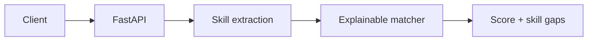

# Resume Parser & Screening System

An explainable resume screening API that extracts a controlled skill vocabulary, compares it with a job description, and returns matched/missing skills plus a transparent score.



## Run

```powershell
python -m venv .venv; .\.venv\Scripts\Activate.ps1
pip install -r requirements.txt
uvicorn app.main:app --reload
pytest
```

POST `/screen` with `{ "resume_text": "...", "job_description": "..." }`. This MVP intentionally returns evidence and gaps rather than making opaque hiring decisions.
